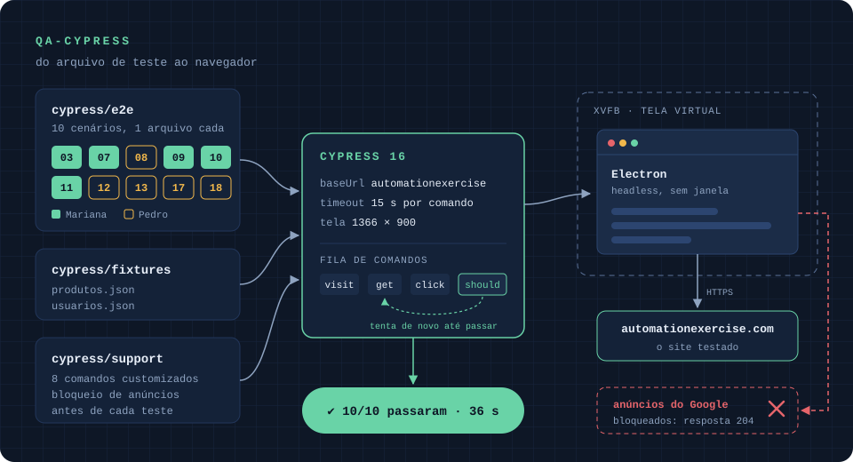

# Trabalho Final - Automação de Testes com Cypress


Automação de 10 cenários de teste do site [Automation Exercise](https://www.automationexercise.com/test_cases) utilizando o framework Cypress.

<p align="center">
  
</p>

## Integrantes

- Mariana Moura
- Pedro Guilherme Sena

## Cenários automatizados

| Caso | Cenário | Arquivo |
| --- | --- | --- |
| 3 | Login User with incorrect email and password | `cypress/e2e/03-login-invalido.cy.js` |
| 7 | Verify Test Cases Page | `cypress/e2e/07-pagina-casos-de-teste.cy.js` |
| 8 | Verify All Products and product detail page | `cypress/e2e/08-lista-e-detalhes-produto.cy.js` |
| 9 | Search Product | `cypress/e2e/09-buscar-produto.cy.js` |
| 10 | Verify Subscription in home page | `cypress/e2e/10-inscricao-pagina-inicial.cy.js` |
| 11 | Verify Subscription in Cart page | `cypress/e2e/11-inscricao-carrinho.cy.js` |
| 12 | Add Products in Cart | `cypress/e2e/12-adicionar-produtos-carrinho.cy.js` |
| 13 | Verify Product quantity in Cart | `cypress/e2e/13-quantidade-carrinho.cy.js` |
| 17 | Remove Products From Cart | `cypress/e2e/17-remover-produto-carrinho.cy.js` |
| 18 | View Category Products | `cypress/e2e/18-produtos-por-categoria.cy.js` |

## Estrutura do projeto

```text
cypress/
├── e2e/        arquivos de teste, um por cenário
├── fixtures/   dados de teste (produtos.json, usuarios.json)
└── support/    comandos customizados e configuração global
docs/
└── fluxo-testes.svg
cypress.config.js
package.json
```

## Pré-requisitos

- Node.js (versão LTS)
- npm

## Instalação

```bash
npm install
```

## Execução

Interface gráfica do Cypress:

```bash
npx cypress open
```

Execução em modo headless (sem interface):

```bash
npm test
```

Execução de um único cenário:

```bash
npx cypress run --spec cypress/e2e/09-buscar-produto.cy.js
```
